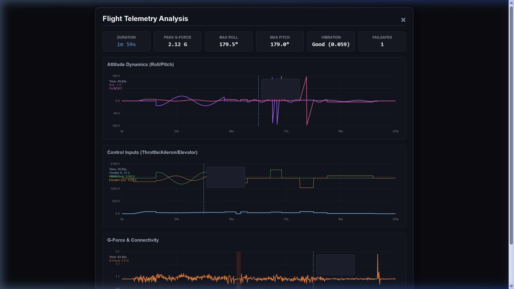

# ESP32-C3 Flight Controller & Telemetry Log Analyzer (CRSF to PWM + IMU Blackbox)

This project is a high-performance **TBS Crossfire (CRSF) to PWM converter** built for the ESP32-C3 (such as the SuperMini). It includes **real-time 3D attitude estimation** (Roll/Pitch complementary filter) via an MPU6050 sensor, **automatic flight blackbox logging** onto the onboard SPI flash (using LittleFS), and an **interactive telemetry analysis dashboard** that runs 100% offline directly in your browser.

---

## 🚀 Key Features

* **CRSF Decoding:** Reads serial CRSF packets from any compatible receiver (ExpressLRS, TBS Crossfire) and decodes channels with failsafe protection.
* **PWM Generation:** Outputs up to 6 high-resolution PWM signals to drive standard RC servos and ESCs.
* **IMU Attitude Estimation:** Computes real-time roll and pitch angles at high frequency using an MPU6050 accelerometer/gyroscope.
* **Automatic Flight Logger:** 
  * Automatically detects flight phases. Logging starts when the receiver is active and either the throttle is raised (>5%) or the AUX arm switch (CH6) is flipped high.
  * Auto-stops logging and closes the file if the connection goes into failsafe or inputs remain idle for more than 5 seconds.
  * Implements RAM buffering to write data in 330-byte chunks to protect SPI flash life and prevent latency.
* **Native In-Browser Analysis (100% Offline):** 
  * Land your plane, connect your phone or PC to the plane's WiFi AP (`RCPlane-FC`), and open `http://192.168.4.1`.
  * Click **Analyze** to download and decode the binary flight log locally in JavaScript.
  * Custom, zero-dependency SVG charting engine renders detailed charts for attitude, servo controls, and G-force loading with snapping hover tooltips.
* **Python Desktop Utility:** Standalone script (`analyze_flight.py`) to download logs, export to structured JSON (`flight_log.json`), and generate interactive HTML reports.

---

## 🔌 Hardware Connections & Wiring

### Connection Diagram


### Pinout Mapping
| Component | Device Pin | ESP32-C3 Pin | Description |
|---|---|---|---|
| **MPU6050** | VCC | 3.3V / 5V | Power |
| **MPU6050** | GND | GND | Ground |
| **MPU6050** | SDA | GPIO 8 | I2C Data |
| **MPU6050** | SCL | GPIO 9 | I2C Clock |
| **CRSF RX** | TX | GPIO 20 (RX) | Serial Input |
| **Servo 1 (Aileron)** | PWM | GPIO 0 | PWM Output |
| **Servo 2 (Elevator)** | PWM | GPIO 1 | PWM Output |
| **Servo 3 (Throttle)** | PWM | GPIO 2 | PWM Output (ESC) |
| **Servo 4 (Rudder)** | PWM | GPIO 3 | PWM Output |
| **Servo 5 (Flaps)** | PWM | GPIO 4 | PWM Output |
| **Servo 6 (AUX/Arm)** | PWM | GPIO 5 | PWM Output |
| **Status LED** | LED | GPIO 8 (Onboard) | Blue Status LED |

---

## 🛠️ Software Setup & Installation

### 1. Arduino IDE Configuration
1. Install **Arduino IDE** and add the ESP32 board manager URL:
   `https://espressif.github.io/arduino-esp32/package_esp32_index.json`
2. Search for and install **esp32** boards (v2.x or v3.x) in the Board Manager.
3. Select board: **ESP32C3 Dev Module**.
4. Set **Partition Scheme** to: **Default 4MB with spiffs/littlefs** or similar to allocate space for flight logs.

### 2. Required Libraries
Install the following libraries via the Arduino Library Manager:
* **Adafruit MPU6050** (along with its dependencies: `Adafruit Unified Sensor` and `Adafruit BusIO`)
* **Wire** & **SPI** (Standard built-in libraries)

### 3. Flash the Board
Compile and upload `CRSF_to_PWM_with_IMU_dashboard.ino` to the ESP32-C3.

---

## 📈 Post-Flight Telemetry Analysis

### Method A: Native In-Browser (100% Offline, Mobile Friendly)
No software installation or internet connection required.
1. Connect your phone, tablet, or laptop to the **RCPlane-FC** WiFi network.
2. Open your web browser and go to `http://192.168.4.1`.
3. In the **Post-Flight Data Logger** card, click **Analyze**.
4. The dashboard will download the binary data and construct interactive graphs detailing your flight stats, G-forces, attitude, and servo controls.



### Method B: Desktop Python Analyzer
Use the Python script on your computer to save logs as JSON and build detailed ground-station reports.
1. Install dependencies:
   ```bash
   pip install requests
   ```
2. Connect to the **RCPlane-FC** WiFi network.
3. Run the script:
   ```bash
   python analyze_flight.py
   ```
   This automatically downloads `flight.log` over WiFi, parses it into `flight_log.json`, and opens `flight_analysis.html` in your default browser.
4. If you already downloaded the file manually, you can analyze it offline:
   ```bash
   python analyze_flight.py -i flight.log
   ```
